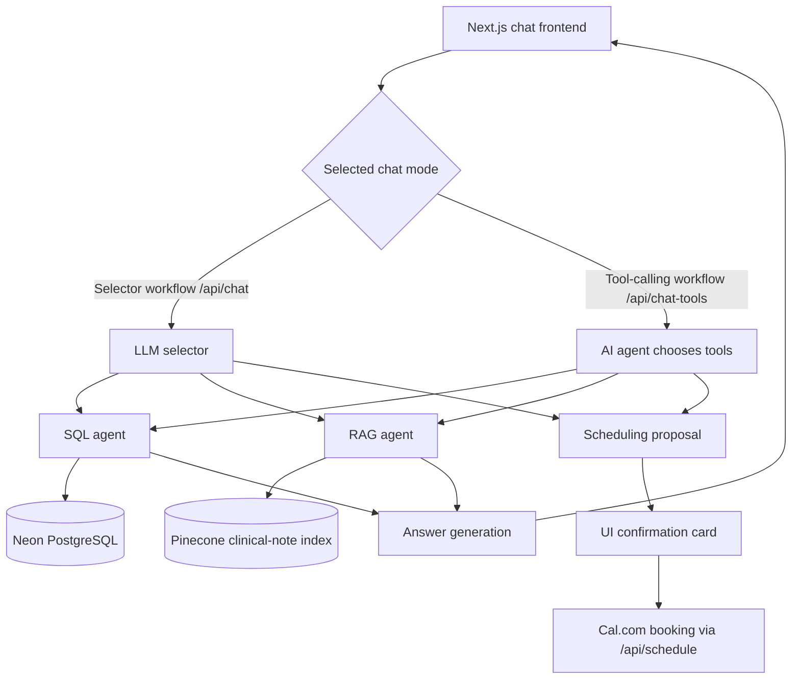

# Medical RAG: AI-Powered Patient Records Assistant

An AI-powered medical records assistant developed during Parsity. It helps staff ask natural-language questions across structured patient records and free-text clinical notes. The application combines LLM-generated SQL against PostgreSQL, semantic retrieval from a Pinecone index, and model-driven tool calling to produce answers grounded in retrieved data.

**Data:** The [Synthea Coherent Dataset](https://synthea.mitre.org/) is fully synthetic educational patient data, not real patient records. The shared, read-only PostgreSQL database contains a roughly 200-patient subset and about 21,000 SOAP-style clinical notes. PostgreSQL is the system of record; the Pinecone index is derived from those notes.

For course context, see [What We're Building](docs/WHAT-WERE-BUILDING.md) and the [data structure guide](docs/DATA_STRUCTURE.md).

## Features

| Capability                        | Implementation                                                                                                                                                                      |
| --------------------------------- | ----------------------------------------------------------------------------------------------------------------------------------------------------------------------------------- |
| Natural-language record questions | The chat UI sends questions and conversation history to the selected route.                                                                                                         |
| Structured data lookup            | A SQL agent generates a PostgreSQL SELECT using the schema and actual distinct condition and state values; a read-only database role limits writes.                                 |
| Clinical note retrieval           | A RAG agent applies exact patient/date filters when present, then uses Pinecone vector search and reranking for note meaning.                                                       |
| Combined SQL + RAG                | Questions needing both sources call both retrieval workers and combine their text for answer generation.                                                                            |
| Agentic tool selection            | A separate /api/chat-tools route lets the model choose SQL, clinical-note search, or both, and returns a tool-call trace.                                                           |
| Appointment scheduling            | Chat proposes an action; the UI presents a confirmation card and posts to Cal.com only after the user confirms. Requires Cal.com configuration; the confirmation gate is in the UI. |
| Tracing                           | LangSmith wraps OpenAI calls when tracing is enabled; the retrieval path also wraps AI SDK answer streaming. This is LLM-call tracing, not end-to-end SQL/Pinecone spans.           |
| Evaluation                        | Vitest runs offline tests; Jev (@typesafe-ai/sdk) scores live answer cases and additional tests inspect tool selection.                                                             |

This is an educational prototype. Its prompts ask for grounded answers and the tool route declines medical advice, but these behaviors are not clinical safety guarantees.

## Architecture



The **selector workflow** (/api/chat) asks an LLM for a routing plan, runs SQL and RAG concurrently when both are needed, and streams a grounded answer through the aggregator. Scheduling takes a separate branch before retrieval. The **tool-calling workflow** (/api/chat-tools) uses the Vercel AI SDK: the model chooses among the existing SQL and RAG agents, a scheduling proposal tool, and an arXiv research tool across multiple steps, then returns a JSON answer and a tool-call trace. The UI offers a toggle between these workflows.

/api/chat-graph and lib/graph.ts are LangGraph coursework scaffolding and currently throw; they are **not** the implemented tool-calling path. The working tool path is /api/chat-tools.

The SQL agent uses text-to-SQL, with no per-question query builder. The database's read-only role is the current write-prevention boundary; a SQL statement validator remains a TODO in lib/agents/sql.ts. Retrieved note matches and SQL rows are passed to the answer model as context. The Pinecone index can be rebuilt from PostgreSQL with npm run vectorize (an API-using, index-writing operation).

## Testing and Evaluation

| Suite                                              | Observed result  | Scope                                                                                             |
| -------------------------------------------------- | ---------------- | ------------------------------------------------------------------------------------------------- |
| Offline Vitest tests                               | **15/15 passed** | Route, agent, vector-search, and scheduling clarification/confirmation behavior with mocks        |
| TypeScript validation                              | **Passed**       | tsc --noEmit                                                                                      |
| Original Jev live evaluations                      | **7/7 passed**   | SQL counts, diagnosis lookups, scheduling wording, medical-advice refusal, and off-topic handling |
| Additional live RAG and tool-selection evaluations | **5/5 passed**   | Clinical-note retrieval, combined SQL + RAG answers, and tool choices                             |
| **Total live evaluations**                         | **12/12 passed** | Observed single-run results                                                                       |

These are supplied results from one completed run, not a measure of production accuracy or reliability. The live suites call the model and, for scored answers, Jev; the extra cases also assert which retrieval tools were called. The separate lib/evals/retrieval.test.ts LLM-judge coursework suite is still incomplete, so its TODOs are not included in the 12 passing live cases.

## Running the Project

Use Node.js 22 or newer. The course database is provided read-only; do not migrate or seed it. Install dependencies and generate the local Prisma client:

```bash
npm install
npm run db:generate
```

The generated client is local; this command does not migrate the shared database. You can inspect the read-only tables with npm run db:studio.

Create a local .env file with credentials supplied for your own setup. The repository does not include an .env.example; the names below are the configuration reference. Never commit .env.

| Variable                                                | Purpose                                                                                      |
| ------------------------------------------------------- | -------------------------------------------------------------------------------------------- |
| DATABASE_URL                                            | Read-only PostgreSQL connection for patient records                                          |
| OPENAI_API_KEY                                          | Model calls and embeddings                                                                   |
| PINECONE_API_KEY, PINECONE_INDEX                        | Clinical-note vector search; the index must already contain vectors for retrieval            |
| DIRECT_URL                                              | Optional direct PostgreSQL connection for the vectorization script                           |
| CAL_API_KEY, CAL_EVENT_TYPE_ID                          | Optional Cal.com booking after UI confirmation                                               |
| CAL_TEST_ATTENDEE_EMAIL                                 | Optional fallback attendee email for the scheduling demo when no patient email is supplied   |
| LANGSMITH_TRACING, LANGSMITH_API_KEY, LANGSMITH_PROJECT | Optional LLM tracing; set the tracing flag to true to enable it                              |
| TYPESAFE_API_KEY                                        | Jev scoring in live evaluations                                                              |
| OPENAI_BASE_URL                                         | Optional OpenAI-compatible proxy URL                                                         |
| EVAL_BASE_URL                                           | Optional URL for the additional live suite and server check (default: http://localhost:3000) |

Start the app at <http://localhost:3000>:

```bash
npm run dev
```

If your Pinecone index has not been populated, the optional vectorization command reads the course database and writes note vectors to your index. It uses OpenAI and Pinecone APIs and may incur charges. Start with a small batch before indexing all notes:

```bash
npm run vectorize -- --limit 5
npm run vectorize
```

The offline test command runs the default Vitest selection; it excludes lib/evals:

```bash
npm run test:run
npx tsc --noEmit
```

Live evaluations require configured API credentials, a reachable database, and a populated Pinecone index. They make paid API calls and may incur charges. Vitest global setup starts a local Next.js dev server if one is not already reachable. The original Jev suite connects specifically to http://localhost:3000; EVAL_BASE_URL applies to the additional clinical-tools suite and the server availability check.

Run the two suites behind the reported 12/12 result separately, or select one named case:

```bash
RUN_EVALS=1 npx vitest run lib/evals/chat.test.ts
RUN_EVALS=1 npx vitest run lib/evals/clinical-tools.test.ts
RUN_EVALS=1 npx vitest run lib/evals/chat.test.ts -t "How many patients have diabetes?"
RUN_EVALS=1 npx vitest run lib/evals/clinical-tools.test.ts -t "combined question calls both retrieval tools"
```

The broader command below also runs the unfinished LLM-judge coursework file, whose implemented tests currently fail because its evaluators still throw. It is not the command behind the reported 12/12 result:

```bash
npm run test:evals
```

Use npm test only when you want Vitest watch mode.

## Engineering Challenges

- **Tool choice:** Compare an explicit selector plan with model-driven tool calls and inspect the returned tool trace.
- **Structured plus unstructured retrieval:** Combine exact SQL facts with semantically matched notes, while applying exact patient and date filters where available.
- **Grounded generation:** Feed retrieved SQL rows and note text to the answer model and instruct it to state when evidence is missing.
- **Action control:** Keep scheduling as a proposal until the user confirms the booking card.
- **Evaluation:** Check both answer criteria and the tools selected for SQL-only, note-only, and combined questions.

## Project Structure

| Path                                       | Role                                                             |
| ------------------------------------------ | ---------------------------------------------------------------- |
| app/page.tsx                               | Chat UI, mode toggle, and scheduling confirmation                |
| app/api/chat/route.ts                      | Selector-based orchestration                                     |
| app/api/chat-tools/route.ts                | Implemented model-driven tool calling                            |
| app/api/chat-graph/route.ts, lib/graph.ts  | Unfinished LangGraph coursework path                             |
| app/api/search/route.ts                    | Direct vector-search endpoint for retrieval inspection           |
| app/api/schedule/route.ts, lib/calendar.ts | Confirmed Cal.com booking                                        |
| lib/agents/selector.ts                     | Structured routing plan                                          |
| lib/agents/sql.ts                          | Schema-grounded text-to-SQL                                      |
| lib/agents/rag.ts, lib/vector-search.ts    | Clinical-note vector retrieval and reranking                     |
| lib/agents/aggregator.ts                   | Streaming answer generation for /api/chat                        |
| lib/openai.ts                              | Model configuration, embeddings, and optional LangSmith wrapping |
| lib/evals/                                 | Jev cases, tool-selection checks, and LLM-judge coursework stubs |
| scripts/vectorize.ts                       | Rebuild the Pinecone note index from PostgreSQL                  |

## Example Questions

| Question                                                                                | Retrieval or action                                               |
| --------------------------------------------------------------------------------------- | ----------------------------------------------------------------- |
| “How many patients have hypertension?”                                                  | SQL aggregation                                                   |
| “How many patients had a heart attack?”                                                 | SQL with condition-value grounding, such as Myocardial Infarction |
| “Which patients are short of breath?”                                                   | Clinical-note vector search                                       |
| “Does a patient have a recorded diabetes diagnosis, and what does a specific note say?” | SQL + RAG                                                         |
| “Book a follow-up appointment on Tuesday at 2 p.m.”                                     | Scheduling proposal, then human confirmation                      |

Avoid lab-threshold demo questions such as “A1C over 9”: the synthetic subset has few qualifying observations.

## Tech Stack

| Component        | Technology                                                                   |
| ---------------- | ---------------------------------------------------------------------------- |
| Frontend and API | Next.js 16.4.2, React, Tailwind CSS                                          |
| Database         | Neon PostgreSQL, Prisma                                                      |
| Vector retrieval | Pinecone, OpenAI text-embedding-3-small (1,536 dimensions), hosted reranking |
| AI workflows     | OpenAI Responses API and Zod, Vercel AI SDK                                  |
| Observability    | Optional LangSmith tracing                                                   |
| Scheduling       | Cal.com                                                                      |
| Testing          | Vitest, Jev (@typesafe-ai/sdk)                                               |

## Course Documentation

The original six-week curriculum remains useful context for this Parsity project:

| Week | Topic                                     | Course material                                           |
| ---- | ----------------------------------------- | --------------------------------------------------------- |
| 1    | RAG ingestion and embeddings              | Vectorize clinical notes into Pinecone; chunking exercise |
| 2    | Retrieval and reranking                   | [Note ingestion challenge](docs/CHALLENGE-NOTE-INGEST.md) |
| 3    | Selector, SQL, RAG, scheduling            | [Tool-calling challenge](docs/CHALLENGE-TOOL-CALLING.md)  |
| 4    | Model-directed tool calling and LangGraph | [LangGraph challenge](docs/CHALLENGE-LANGGRAPH.md)        |
| 5    | Evaluation and security                   | Query-log evaluations and poisoned-document exercise      |
| 6    | Demo                                      | Present an engineering decision with evidence             |

The course capstone runs alongside weeks 5–6. Weekly challenges include a short video explaining the implementation and its tradeoffs. The repository also includes [in-class visuals](visuals/README.md) and the [data structure guide](docs/DATA_STRUCTURE.md).

Clinical notes average roughly 450 characters in this course subset, so a note is usually one vector chunk. The separate Bible homework exercises longer-text chunking.

## Resources

- [RAG overview](https://www.pinecone.io/learn/retrieval-augmented-generation/)
- [OpenAI embeddings](https://platform.openai.com/docs/guides/embeddings)
- [Pinecone documentation](https://docs.pinecone.io/) and [reranking guide](https://docs.pinecone.io/guides/search/rerank-results)
- [Anthropic: Building Effective Agents](https://www.anthropic.com/research/building-effective-agents)
- [LangGraph JavaScript quickstart](https://docs.langchain.com/oss/javascript/langgraph/quickstart)
- [Prisma documentation](https://www.prisma.io/docs)
